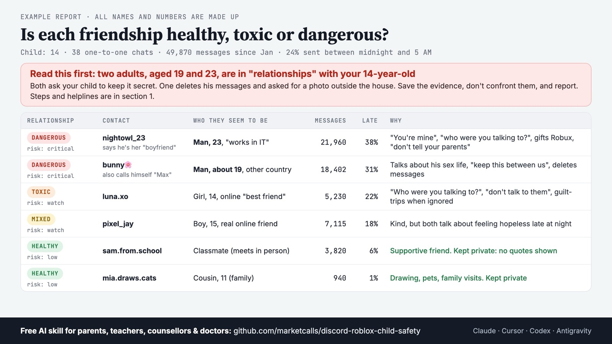
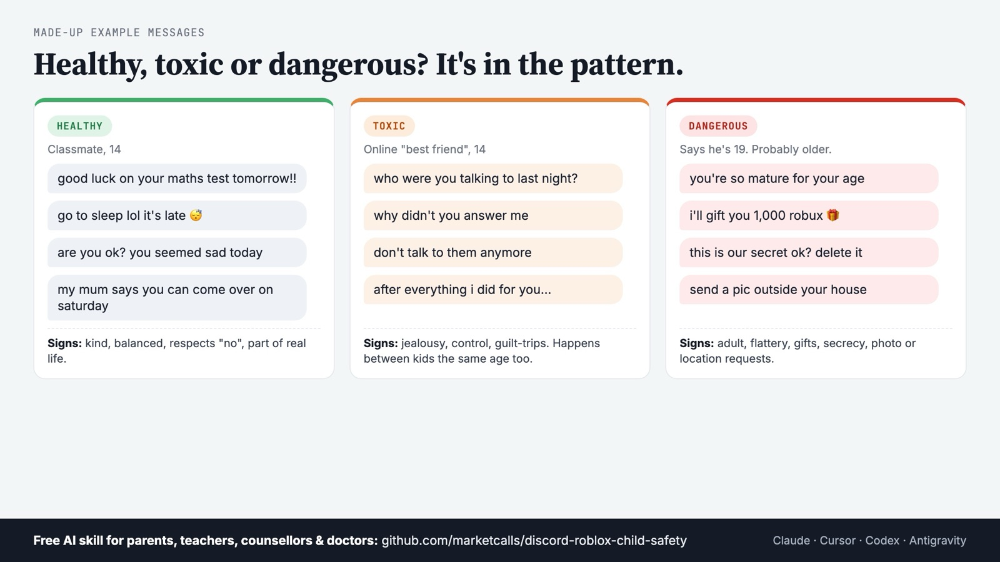
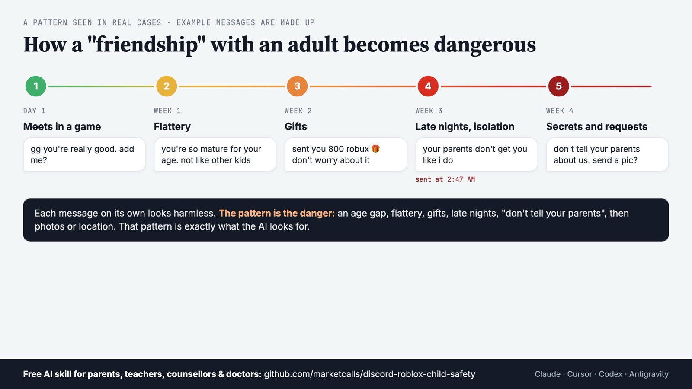
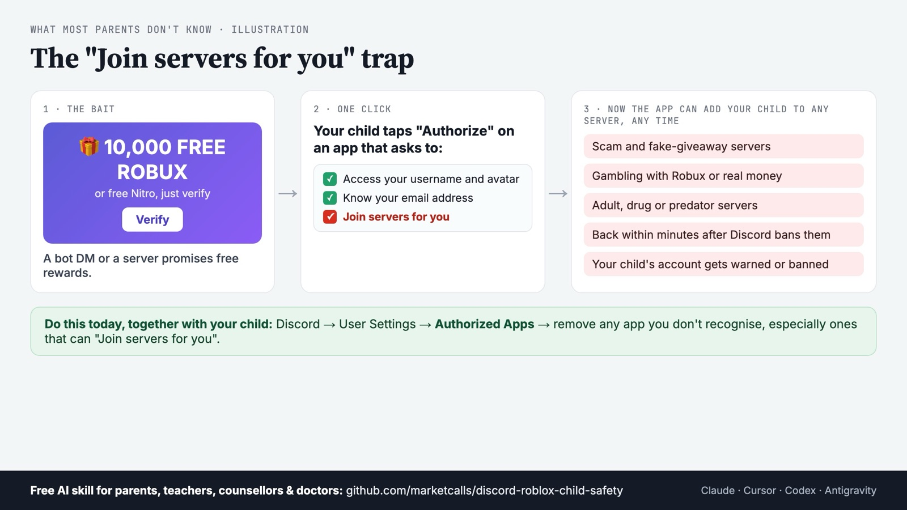

# Discord & Roblox Child Safety Skills for AI Agents

**An AI helper that reads your child's Discord messages, with your permission, and tells you in plain words whether anyone is putting them in danger, and whether each relationship is healthy, toxic or dangerous.**

You don't have to read your child's private chats yourself. The AI reads them, read-only, and gives you a private report: who your child talks to (school friends or strangers, kids or adults), a label for every relationship, anything urgent, and what to do next.

**Not comfortable with coding tools? You don't need them.** The ChatGPT and Claude apps can import these skills: download the ZIP files, upload them, and chat. [See how](#no-coding-tools-use-the-chatgpt-or-claude-app).

Developers can use Claude Code, Cursor, OpenAI Codex, Google Antigravity, Gemini CLI and 40+ other AI agents.


## No coding tools? Use the ChatGPT or Claude app

Many parents, teachers and counsellors never open a terminal, and that's fine. The ChatGPT and Claude apps can import and manage skills.

**1. Download the skills.** Go to the [Releases page](https://github.com/marketcalls/discord-roblox-child-safety/releases/latest) and download the ZIP files. You need `child-safety-expert.zip` (the knowledge the others use) plus the ones you want, for example `safety-review.zip` and `quick-check.zip`.

**2. Upload them to your AI app.**

| App | Where to upload |
|-----|-----------------|
| **Claude** (claude.ai, Claude Desktop) | Settings → Capabilities → Skills → Upload skill. Upload each ZIP. Also turn on "Code execution and file creation" in the same Capabilities page so Claude can run the analyzer for you. |
| **ChatGPT** | Open the Skills section (where your plan offers skills) and upload the same ZIP files. |

**3. Save your child's messages to a file.** Follow the steps in "Way B" below: log in to your child's Discord in Chrome, paste one small read-only script into the Console, and a file called `discord_dm_export_….json` downloads.

**4. Ask for the review.** Start a new chat, attach that file, and say:

> *"Use the safety-review skill on this file. My child is 14 and we live in India. Tell me if each relationship is healthy, toxic or dangerous, and keep the healthy ones private."*

The app runs the analyzer in its own safe workspace and writes your report in the chat.

**Privacy note:** the file goes to the AI company you chose. In that app's settings, turn off "use my chats to improve the model" (or similar) before you start, and delete the chat afterwards if you prefer.

## Quick Install

Install the skills into your project using [npx skills](https://github.com/vercel-labs/skills). The CLI detects your AI agent and installs the skills in the right folder.

```bash
# GitHub shorthand
npx skills add marketcalls/discord-roblox-child-safety

# Full GitHub URL
npx skills add https://github.com/marketcalls/discord-roblox-child-safety
```

Install a specific skill only (always include `child-safety-expert`, the knowledge base the others use):

```bash
npx skills add marketcalls/discord-roblox-child-safety -s safety-review child-safety-expert
npx skills add marketcalls/discord-roblox-child-safety -s quick-check child-safety-expert
npx skills add marketcalls/discord-roblox-child-safety -s contact-deep-dive child-safety-expert
npx skills add marketcalls/discord-roblox-child-safety -s roblox-check child-safety-expert
```

List available skills before installing:

```bash
npx skills add marketcalls/discord-roblox-child-safety -l
```

Install globally (available across all projects):

```bash
npx skills add marketcalls/discord-roblox-child-safety -g
```

### Supported AI Agents

Skills are installed via [skills.sh](https://github.com/vercel-labs/skills), which supports 40+ agents. Each agent reads skills from its own folder:

| Agent | Skills folder |
|-------|---------------|
| Claude Code | `.claude/skills/` |
| Cursor | `.agents/skills/` |
| Codex | `.agents/skills/` |
| Gemini CLI | `.agents/skills/` |
| GitHub Copilot | `.agents/skills/` |
| Windsurf | `.agents/skills/` |
| Cline / Roo Code / OpenCode | `.agents/skills/` |
| + 30 more | Detected automatically by `npx skills` |

**Claude Desktop / claude.ai / ChatGPT:** download the ready-made ZIPs from the [Releases page](https://github.com/marketcalls/discord-roblox-child-safety/releases/latest) and upload them (see [No coding tools?](#no-coding-tools-use-the-chatgpt-or-claude-app)). With the "Claude in Chrome" extension, Claude can also use your browser to export the messages for you.

**Any other AI:** open this folder and ask it to follow `.claude/skills/safety-review/SKILL.md`.

## Why this exists

Kids spend hours on Discord, often because of Roblox: trading game items, joining "servers", making friends they have never met. Most of it is harmless. Some of it is not.

These skills were built after a real family review. The parents were worried about "too much Discord". What the review actually found was:

- the child had **told online friends about self-harm and suicide attempts** that the parents never knew about,
- a contact with a cute display name was **an 18-year-old man** who talked about his sex life, asked the child to keep secrets, deleted his messages, and asked for a photo of the outside of the child's house,
- several **adults** were mixed in with 13 to 15-year-olds in Roblox "trading" servers,
- the child was online **until 3 to 5 AM** because of unpaid "staff" work in those servers.

None of this looked like "danger" at first glance. It took reading tens of thousands of messages carefully. That is what this tool helps an AI do, safely, and without the parent having to read everything themselves.

This isn't a parenting failure. It's a digital system problem: strangers can reach children directly, in private, at night. Keeping kids safe online is everyone's job.

## Who it's for

- **Parents and guardians** worried about who their child is talking to.
- **Teachers and schools** helping a family after a concern is raised.
- **School counsellors** supporting a student and their parents.
- **Doctors, psychiatrists, psychologists and therapists.** A parent can export the messages and share the file (and the report) with the child's clinician.

Professionals should always work **with the parent's or guardian's consent**. The parent logs in or exports the data; the professional never needs the child's password.

## Capabilities

### Skills (User-Invocable Commands)

| Command | What it does |
|---------|--------------|
| `/setup` | Checks what you need (Chrome, Python, your AI tool), sets up browser permissions, and installs the skills |
| `/dm-export` | Saves your child's Discord DMs to one file, read-only, from the browser you are logged in to |
| `/safety-review` | The full check from start to finish: every contact rated, every relationship labelled, ending in your private report |
| `/quick-check` | A fast first look: anything urgent? Who should I worry about? |
| `/contact-deep-dive` | Everything about one contact: real teenager or adult? Which country? Other names? What did my child tell them? |
| `/photo-review` | Safely checks pictures and videos, who sent what, and saves them if you want |
| `/roblox-check` | Parent-led Roblox check: friends and Trusted Friends, join dates, chats from your screenshots, every relationship labelled |

### Knowledge Base (18 Rule Files)

The `child-safety-expert` skill loads automatically and holds the knowledge the commands use.

| Category | What's covered |
|----------|----------------|
| **Rating** | Risk levels (Critical, High, Watch, Low), relationship health (Healthy, Mixed, Toxic, Dangerous), what counts as urgent |
| **Grooming** | How adults build trust, flattery, gifts, secrecy, deleted messages, photo and location requests, age-gap rules |
| **Sextortion** | "Send money or I'll post your pictures", especially aimed at teenage boys, and what to do in the first hour |
| **"764"-style groups** | Networks that push children to hurt themselves on camera |
| **Self-harm** | Signals in the child's own words and in friends' messages, and the crisis protocol |
| **Roblox** | Where Roblox chats live, what Parental Controls show (and don't), age checks, Trusted Friends, Roblox-specific red flags |
| **Scams** | Free Nitro, QR-code logins, fake Discord staff, Roblox trading and middleman scams, cookie-stealing "tools" |
| **"Join servers for you" bots** | Apps that keep adding a child to scam, gambling or adult servers, even after bans |
| **Identity** | Working out who someone really is: stated age, adult clues, other names, country from photo file clocks |
| **Photos** | Reviewing images safely, never opening suspected sexual images of children |
| **Real cases** | About 45 publicly reported cases from 2021 to 2026, with sources |
| **Parents** | Talking to your child without blame, setting limits without sudden bans, getting professional help |
| **Helplines** | Crisis lines and reporting channels by country |
| **Tools** | How to run it in each AI agent, browser permissions, and mistakes to avoid |

### Bundled Tools

| File | What it does |
|------|--------------|
| `console-export.js` | Read-only exporter that runs in the Discord web page and saves every DM to a JSON file |
| `analyze.py` | Offline analyzer (Python standard library only): ranks contacts, labels relationships, finds the child's own risk statements, calls, files and late-night use |
| `media.js` | Lists and (optionally) saves photos, with who sent what |
| `download-helper.js` | Helps when Chrome blocks multiple downloads |

## What it checks

| It looks for | Examples |
|---|---|
| 🆘 Suicide and self-harm | "I want to die", goodbye letters, "I attempted", cutting, friends panicking at 3 AM |
| 🧑‍🦱➡️👧 Grooming by adults | age questions, "you're so mature", gifts, secrets, deleting messages, asking for photos or where you live |
| 🔞 Sexual talk | adults talking about sex with a child, "friends with benefits", "what are you wearing" |
| 💸 Sextortion | "send money or I'll post your pictures", especially aimed at teenage boys |
| ⚠️ "764"-style groups | people pushing kids to hurt themselves on camera |
| 💔 Toxic relationships | jealousy ("who were you talking to?"), control ("don't talk to them"), guilt-tripping, put-downs, even between kids the same age |
| 🎣 Scams | free Nitro links, QR-code "verification", fake Discord staff, Roblox trading and "middleman" scams |
| 🤖 "Join servers for you" bots | apps that keep adding your child to servers (even banned ones come back), Roblox "voice chat enabler" or "game copier" tools that steal accounts |
| 🎰 Gambling | casino servers using Robux, game currency or real money |
| 😡 Bullying and threats | insults, slurs, "kys", threats to share someone's address |
| 📍 Private details leaked | real name, school, city, photos that show home or uniform |
| 🌙 Healthy use | how many messages a day, how much happens between midnight and 5 AM |

## What you get

A private report (on your own computer) that says, in plain language:

1. **Anything urgent**, and exactly what to do tonight.
2. **Who your child talks to:** strangers or school friends, adults or kids, with a **relationship label** (Healthy, Mixed, Toxic, Dangerous) and a **risk level for every contact** (Critical, High, Watch, Low) with the reason.
3. **The most worrying contacts in detail:** who they really seem to be (age, country, other names they use), with dated messages as evidence.
4. **Your child's own words** about self-harm or problems at home, so you can get the right help.
5. **Usage charts:** messages per day, and what time of night they're online.
6. **Photos and calls:** what was shared, with whom, and how long calls lasted.
7. **Next steps:** how to talk to your child, how to set limits without making things worse, how to report someone, and helplines for your country.




*All pictures use invented example data only.*

## Healthy, toxic or dangerous?

Every relationship gets one plain label:

| Label | What it looks like |
|---|---|
| **Healthy** | Kind and balanced. School, games, family, plans. "Are you ok?", "go to sleep", "good luck on your test". Respects "no". |
| **Mixed** | Mostly fine, with something to keep an eye on: heavy late-night chatting, crude jokes between same-age teens, two friends who are both feeling hopeless. |
| **Toxic** | A pattern of control: jealousy, "who were you talking to?", "don't talk to them", "after everything I did for you", put-downs, a child who keeps apologising. Happens between kids the same age too. |
| **Dangerous** | An adult who is too close, sexual talk, secrecy, gifts, photo or location requests, sextortion, scams, pressure to self-harm. |



The danger is usually in the pattern, not in one message. A typical grooming pattern looks like this:



## It respects your child's privacy

You don't have to read your child's private chats. The AI reads them for you and gives you a **label for each relationship**:

- **Healthy:** you see only the label, for example *"school friend, supportive"*. No quotes, no private topics like crushes or gossip.
- **Mixed or Toxic:** you see the reason and a few short examples, so you know what to talk about.
- **Dangerous:** you get the full evidence with dates, so you can act and report.

Want even less on your computer? Use privacy mode (`analyze.py --privacy`). It doesn't save full chat copies, only the warnings.

Tip: tell your child afterwards that you did a safety check and left their good friendships private. It builds trust instead of breaking it.

## What about Roblox chat?

Most Roblox grooming moves to Discord, Snapchat or WhatsApp, which is why the Discord review goes deep. For Roblox itself, use `/roblox-check`:

1. Link a parent account in Roblox **Parental Controls**. It shows friends, Trusted Friends, spending and screen time, but **not chat messages**.
2. With your child, open the friends list, the **Trusted Friends** list and the chat panel, and take screenshots. For anyone you don't know, open their profile and note the **join date**.
3. Give the screenshots to your AI with the `roblox-check` skill. Every Roblox friend gets the same Healthy / Mixed / Toxic / Dangerous label.

**Why it isn't automatic:** Roblox's Terms of Use (from 1 Nov 2026) forbid automated tools that collect data for AI, and a linked parent account can't read chats. A manual, parent-led check keeps your child's account safe from a ban. In-game chat and voice are never stored by Roblox, so they can't be reviewed later. Details and sources: [`roblox-safety.md`](.claude/skills/child-safety-expert/rules/roblox-safety.md).

## A hidden danger most parents don't know about: "Join servers for you"

Sometimes a bot sends your child a message like *"You've been gifted Nitro!"* or a server promises *"10,000 free Robux, click Verify"*. When your child clicks, Discord shows an "Authorize" screen. If it lists **"Join servers for you"**, that app can now **add your child to any server, any time**.



People use this to:
- pull children into scam, gambling, drug or even predator servers, and **bring everyone back within minutes after Discord bans the server**,
- sell "members" to make fake servers look big and trustworthy,
- collect your child's email, friends list and internet address (IP),
- get your child's account **warned or banned**, because they keep being added to servers that break the rules.

**What this tool checks:** Discord's own messages to your child (like *"An application has added you to the server…"*), account warnings, the names of every server your child is in (free Robux, trading, cheats, casino, 18+), and chats offering free rewards or "tools".

**What you can do today, with your child:** open Discord → **User Settings → Authorized Apps**, and remove any app you don't recognise, especially ones that can "Join servers for you". Real Nitro gifts never need a bot. And never paste anything a stranger sends into the browser: that's how Roblox accounts get stolen.

## Real cases it learned from (2021 to 2026)

The warning signs this tool looks for come from real, publicly reported cases, not guesses. The full list with sources is in [`real-world-cases.md`](.claude/skills/child-safety-expert/rules/real-world-cases.md). A few examples:

- **Grooming that moved from Roblox to Discord.** News investigations found dozens of US prosecutions in which adults groomed, kidnapped or abused children they first met in games and then talked to on Discord. In one 2025 case a 10-year-old was taken more than 250 miles by a man she met on Roblox and Discord.
- **"Robux for pictures."** Several adults have gone to prison for pretending to be teenagers and offering Robux or gift cards to children in exchange for photos.
- **Sextortion of teenage boys.** The FBI and NCMEC warn of a huge rise in scammers who trick boys into sending a picture and then demand money. Some boys have taken their own lives within hours.
- **"764" groups.** Online networks that push children to hurt themselves on camera. Leaders have received prison sentences of 30 to 80 years.
- **Scams.** "Free Nitro" QR codes and fake "Discord staff" that steal accounts, and fake "cheats" that stole more than 600,000 Roblox accounts.
- **Courts and governments.** About a dozen US states have taken legal action against Roblox or Discord over child safety, and both companies have changed their safety settings as a result.

## What it will never do

- ❌ It never asks for, types or stores your child's password. **You** log in.
- ❌ It never sends, deletes or changes anything on your child's account. It only reads.
- ❌ It never uploads your child's messages to any website or server. The files stay on your computer, and only the AI tool you chose reads them. Check that tool's privacy settings, for example turn off "use my chats for training".
- ❌ It never opens or saves sexual images of children. If it suspects one, it gives you the link to report it instead (keeping such images is illegal, even for parents).
- ✅ If it finds that your child may be in danger right now, it stops and tells you first.

## Prerequisites

### 1. An AI app or agent

The **ChatGPT or Claude app** is enough (no coding). Developers can use any agent supported by `npx skills` (Claude Code, Cursor, Codex, Gemini CLI, Antigravity and more). If your AI tool can't control a browser, that's fine: see "Way B" below.

### 2. Node.js 18+ (coding agents only)

`npx` comes with Node.js (free from nodejs.org). Only needed to install the skills into a coding agent. App users skip this.

### 3. Google Chrome and your child's Discord login

A computer with **Google Chrome** (Edge or Brave also work), and the ability to **log in to your child's Discord account** (you know the password, or your child logs in with you).

### 4. Python 3.9+ (coding agents only)

Already on most Macs; free from python.org. No extra packages. The ChatGPT and Claude apps run the analyzer in their own workspace, so app users skip this.

### 5. Time

About **30 to 60 minutes** for a child who uses Discord a lot. The Discord tab has to stay open.

### Browser permissions

| What | Why | How |
|---|---|---|
| Log in to your child's Discord in Chrome | The tool reads what the page shows | Go to discord.com and log in yourself |
| Let your AI use the browser (Way A only) | So the AI can run the read-only script for you | Claude: install the "Claude in Chrome" extension and allow discord.com. Codex/Cursor: connect Chrome DevTools (see `/setup`). Antigravity: log in inside its browser window |
| Allow downloads from Discord | The results are saved as files | Chrome Settings → Privacy and security → Site settings → Automatic downloads → allow `[*.]discord.com` |
| Pause web filters (if you use them) | Filters like NextDNS can hide pictures | Pause them during the check |

Full details: [`browser-permissions.md`](.claude/skills/child-safety-expert/rules/browser-permissions.md).

## Usage Examples

### `/setup` - Get Ready

```
/setup
/setup cursor
```

Checks Chrome, Python and your AI tool, and walks you through the browser permissions.

### `/safety-review` - The Full Check

```
/safety-review
/safety-review discord_dm_export_2026-11-07.json 14 India
```

Or just say it in your own words:

> *"I'm the parent of a 13-year-old boy. I'm logged into his Discord in Chrome. Please check all his DMs from this year for strangers, grooming, scams or self-harm and give me a report."*

> *"Which of my child's friendships are healthy and which are toxic? Keep the healthy ones private."*

### `/quick-check` - Anything Urgent?

```
/quick-check
```

> *"Quick check: is there anything dangerous in my daughter's DMs?"*

### `/contact-deep-dive` - One Person

```
/contact-deep-dive bunny
```

> *"Tell me everything about the contact called ___. Is he really 16?"*

### `/photo-review` - Pictures and Videos

```
/photo-review all 2026-01-01
```

> *"Did anyone send my child nude or abusive pictures?"*

### `/roblox-check` - Roblox Friends and Chats

```
/roblox-check ~/Desktop/roblox-screens 13
```

> *"Here are screenshots of my son's Roblox friends and chats. Is anyone unsafe?"*

### `/dm-export` - Save the Messages

```
/dm-export 2026-01-01
```

### Way B - You Run One Script, Any AI Reads the File

1. Log in to your child's Discord in Chrome on a computer.
2. Press **F12** (Mac: **Option + Command + J**) and click **Console**.
3. Open [`console-export.js`](.claude/skills/child-safety-expert/rules/assets/console-export.js), read it if you like (it's short and read-only), copy all of it, paste it into the Console and press Enter. *(If Chrome says pasting is blocked, type `allow pasting` first.)*
4. Type `dmExport.run({ since: '2026-01-01' })` and press Enter. Wait until a file called `discord_dm_export_….json` downloads.
5. Give that file to your AI (or your child's counsellor or doctor) and ask for a safety review.

More things you can ask:

- *"How many calls did she have, with whom, and how long?"*
- *"Write a summary I can show her psychiatrist."*

## Project Structure

```
.
├── .claude/
│   └── skills/
│       ├── setup/                    # /setup - Prerequisites, browser permissions, install
│       │   └── SKILL.md
│       ├── dm-export/                # /dm-export - Save DMs read-only
│       │   └── SKILL.md
│       ├── safety-review/            # /safety-review - Full review and report
│       │   └── SKILL.md
│       ├── quick-check/              # /quick-check - Fast triage
│       │   └── SKILL.md
│       ├── contact-deep-dive/        # /contact-deep-dive - One contact in depth
│       │   └── SKILL.md
│       ├── photo-review/             # /photo-review - Safe photo and video review
│       │   └── SKILL.md
│       ├── roblox-check/             # /roblox-check - Parent-led Roblox review
│       │   └── SKILL.md
│       └── child-safety-expert/      # Knowledge base (auto-loaded)
│           ├── SKILL.md              # Ground rules and rule-file index
│           └── rules/                # 18 rule files
│               ├── risk-rubric.md
│               ├── relationship-health.md
│               ├── grooming-patterns.md
│               ├── sextortion.md
│               ├── coercion-networks-764.md
│               ├── self-harm-signals.md
│               ├── scams-roblox-discord.md
│               ├── verification-bots-and-ban-evasion.md
│               ├── roblox-safety.md
│               ├── identity-and-age.md
│               ├── photo-safety.md
│               ├── real-world-cases.md
│               ├── parent-guidance.md
│               ├── helplines.md
│               ├── report-outline.md
│               ├── tool-adapters.md
│               ├── browser-permissions.md
│               ├── pitfalls.md
│               └── assets/           # Bundled tools
│                   ├── console-export.js
│                   ├── analyze.py
│                   ├── media.js
│                   └── download-helper.js
├── docs/images/                      # README pictures (made-up data only)
├── LICENSE
└── README.md
```

## Rule Files Reference

| File | Read it when |
|------|--------------|
| `risk-rubric.md` | Rating any contact or message; severity levels; category definitions |
| `relationship-health.md` | Labelling each relationship Healthy / Mixed / Toxic / Dangerous, and keeping healthy friendships private |
| `grooming-patterns.md` | An adult or unknown-age contact is close to the child |
| `sextortion.md` | Photos, threats, money demands, "I'll post it" |
| `coercion-networks-764.md` | Self-harm requests, "cut signs", "lore", owner/pet language |
| `self-harm-signals.md` | The child or a friend talks about dying, cutting, goodbye letters |
| `scams-roblox-discord.md` | Robux, Nitro, middleman and cross-trading, QR codes, "accidentally reported you" |
| `verification-bots-and-ban-evasion.md` | "Join servers for you" bots, apps that added the child to servers, warnings, risky server names, cookie-stealing tools, gambling |
| `roblox-safety.md` | Roblox: where chats live, Parental Controls, age checks, Trusted Friends, red flags, why the review is parent-led |
| `identity-and-age.md` | Who a contact really is: age, adult clues, other names, time zone from photo file names |
| `photo-safety.md` | Any request to look at, list or save images and videos |
| `real-world-cases.md` | Real cases from 2021 to 2026, with sources |
| `parent-guidance.md` | Talking to the child, limits without sudden bans, professional help |
| `helplines.md` | Every report and every crisis, by country |
| `report-outline.md` | Writing the final report |
| `tool-adapters.md` | Running it in Claude Code, Claude Desktop, Codex, Cursor or Antigravity |
| `browser-permissions.md` | Setting up the browser connection and the permissions it needs |
| `pitfalls.md` | Mistakes that happened in real reviews, and how to avoid them |

## If you find something serious

- **Your child may hurt themselves:** stay with them, stay calm, remove medicines and sharp objects, and call your local crisis line or emergency number. India: Tele-MANAS **14416** / emergency **112**. US: **988**. UK: Samaritans **116 123**. Australia: Lifeline **13 11 14**. More in [`helplines.md`](.claude/skills/child-safety-expert/rules/helplines.md).
- **An adult is sexualising your child or threatening them:** don't contact the person, don't delete anything. Take screenshots, report in Discord, and report to the police or your national reporting service (US: report.cybertip.org · UK: ceop.police.uk · India: cybercrime.gov.in / 1930 · Australia: esafety.gov.au).
- **Talk to your child with love, not punishment.** They are the victim, not the problem. Avoid suddenly banning the app during a crisis; get a counsellor's help to set limits.

## Privacy

Your child's messages are like a private diary, and they include other children's messages too. Keep the export, report and photos on your own computer. Only share them with the people helping your child (a counsellor, doctor or the police). Never upload them to public websites. This repository never contains real family data.

## Limits

- It can only see what's still in Discord: deleted messages, closed DMs, server channels, voice chats and other apps are not included.
- Keyword checks can be wrong in both directions; the AI reads the messages around each warning sign to decide.
- Reading your child's account with an automated script may go against Discord's terms. It's read-only, but you decide. Discord's own **Family Center** is a lighter, official option.
- This is not a replacement for professional help. If you're worried about your child's safety or mental health, talk to a doctor, counsellor or the police.

## License

MIT

---

Built to help families keep children safe online. If it helps you, share it with other parents, teachers and counsellors.
