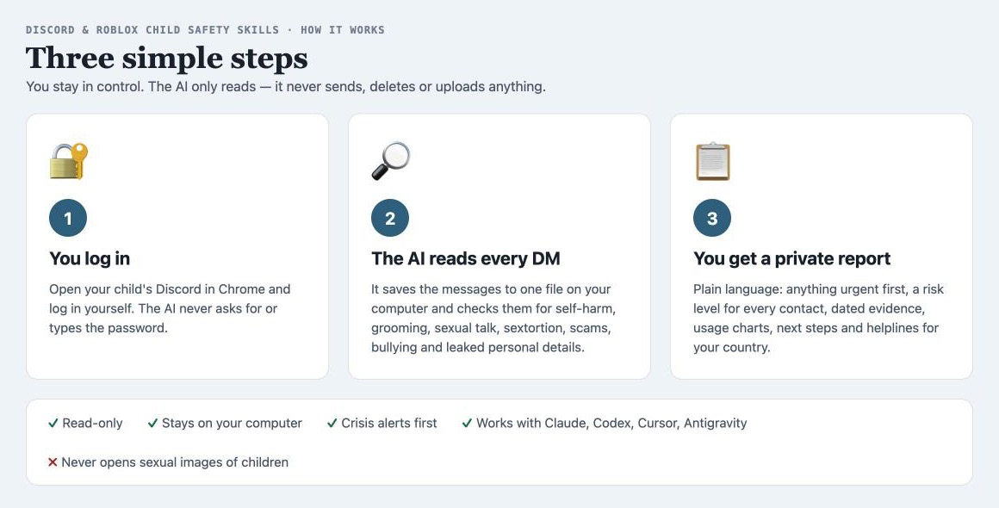
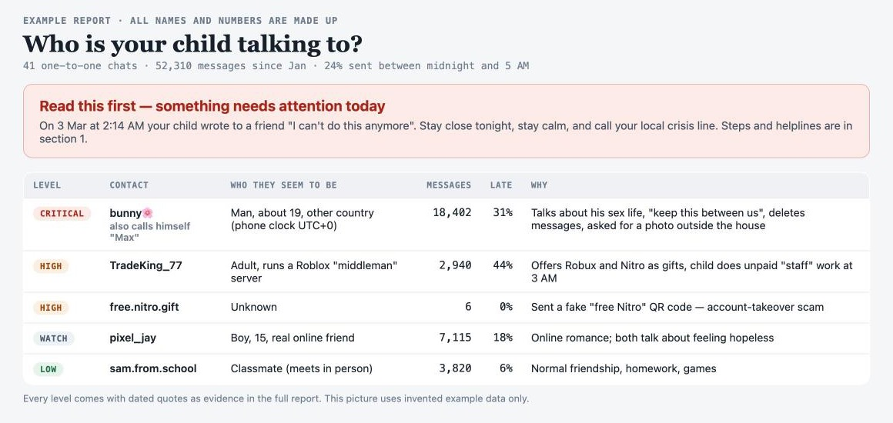
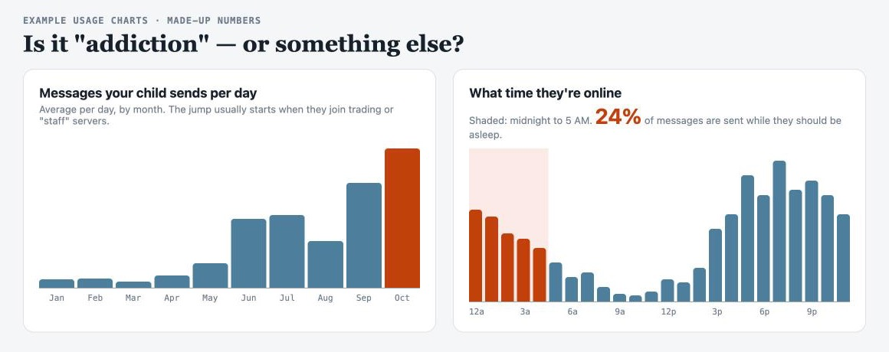

# Discord & Roblox Child Safety Skills

**An AI helper that reads your child's Discord messages — with your permission — and tells you in plain words whether anyone is putting them in danger.**

It works with Claude Code, Claude Desktop, OpenAI Codex, Cursor and Google Antigravity, and even with AI tools that can't use a browser (you run one small script yourself, then the AI reads the file).



---

## Why this exists

Kids spend hours on Discord, often because of Roblox: trading game items, joining "servers", making friends they have never met. Most of it is harmless. Some of it is not.

These skills were built after a real family review. The parents were worried about "too much Discord". What the review actually found was:

- the child had **told online friends about self-harm and suicide attempts** that the parents never knew about,
- a contact with a cute display name was **an 18-year-old man** who talked about his sex life, asked the child to keep secrets, deleted his messages, and asked for a photo of the outside of the child's house,
- several **adults** were mixed in with 13–15-year-olds in Roblox "trading" servers,
- the child was online **until 3–5 AM** because of unpaid "staff" work in those servers.

None of this showed up as "danger" at first glance. It took reading tens of thousands of messages carefully. That is what this tool helps an AI do — safely, and without the parent having to read everything themselves.

## Who it's for

- **Parents and guardians** worried about who their child is talking to.
- **Teachers and schools** helping a family after a concern is raised.
- **School counsellors** supporting a student and their parents.
- **Doctors, psychiatrists, psychologists and therapists** — a parent can export the messages and share the file (and the report) with the child's clinician.

Professionals should always work **with the parent's or guardian's consent**. The parent logs in or exports the data; the professional never needs the child's password.

## What it checks

| It looks for | Examples |
|---|---|
| 🆘 Suicide and self-harm | "I want to die", goodbye letters, "I attempted", cutting, friends panicking at 3 AM |
| 🧑‍🦱➡️👧 Grooming by adults | age questions, "you're so mature", gifts, secrets, deleting messages, asking for photos or where you live |
| 🔞 Sexual talk | adults talking about sex with a child, "friends with benefits", "what are you wearing" |
| 💸 Sextortion | "send money or I'll post your pictures" — especially aimed at teenage boys |
| ⚠️ "764"-style groups | people pushing kids to hurt themselves on camera |
| 🎣 Scams | free Nitro links, QR-code "verification", fake Discord staff, Roblox trading and "middleman" scams |
| 🤖 "Join servers for you" bots | apps that keep adding your child to servers (even banned ones come back), Roblox "voice chat enabler" / "game copier" tools that steal accounts |
| 🎰 Gambling | casino servers using Robux, game currency or real money |
| 😡 Bullying and threats | insults, slurs, "kys", threats to share someone's address |
| 📍 Private details leaked | real name, school, city, photos that show home or uniform |
| 💚 Relationship health | is each friendship **healthy, mixed, toxic or dangerous**? Jealousy, control ("who were you talking to?"), guilt-tripping and put-downs count too, even between kids the same age |
| 🌙 Healthy use | how many messages a day, how much happens between midnight and 5 AM |

## What you get

A private report (on your own computer) that says, in plain language:

1. **Anything urgent** — and exactly what to do tonight.
2. **Who your child talks to** — strangers or school friends, adults or kids — with a **relationship label** (Looks healthy, Mixed, Unhealthy/toxic, Dangerous) and a **risk level for every contact** (Critical, High, Watch, Low) with the reason.
3. **The most worrying contacts in detail** — who they really seem to be (age, country, other names they use), with dated messages as evidence.
4. **Your child's own words** about self-harm or problems at home, so you can get the right help.
5. **Usage charts** — messages per day, and what time of night they're online.
6. **Photos and calls** — what was shared, with whom, and how long calls lasted.
7. **Next steps** — how to talk to your child, how to set limits without making things worse, how to report someone, and helplines for your country.





*Pictures use invented example data only.*

## It respects your child's privacy

You don't have to read your child's private chats. The AI reads them for you and gives you a **label for each relationship**:

- **Looks healthy:** you see only the label, for example *"school friend, supportive"*. No quotes, no private topics like crushes or gossip.
- **Mixed / Unhealthy (toxic):** you see the reason and a few short examples, so you know what to talk about.
- **Dangerous:** you get the full evidence with dates, so you can act and report.

Want even less on your computer? Use privacy mode (`analyze.py --privacy`). It doesn't save full chat copies, only the warnings.

Tip: tell your child afterwards that you did a safety check and left their good friendships private. It builds trust instead of breaking it.

## Real cases it learned from (2021–2026)

The warning signs this tool looks for come from real, publicly reported cases, not guesses. The full list with sources is in [`real-world-cases.md`](.claude/skills/child-safety-expert/rules/real-world-cases.md). A few examples:

- **Grooming that moved from Roblox to Discord.** News investigations found dozens of US prosecutions in which adults groomed, kidnapped or abused children they first met in games and then talked to on Discord. In one 2025 case a 10-year-old was taken more than 250 miles by a man she met on Roblox and Discord.
- **"Robux for pictures."** Several adults have gone to prison for pretending to be teenagers and offering Robux or gift cards to children in exchange for photos.
- **Sextortion of teenage boys.** The FBI and NCMEC warn of a huge rise in scammers who trick boys into sending a picture and then demand money. Some boys have taken their own lives within hours.
- **"764" groups.** Online networks that push children to hurt themselves on camera. Leaders have received prison sentences of 30 to 80 years.
- **Scams.** "Free Nitro" QR codes and fake "Discord staff" that steal accounts, and fake "cheats" that stole more than 600,000 Roblox accounts.
- **Courts and governments.** About a dozen US states have taken legal action against Roblox or Discord over child safety, and both companies have changed their safety settings as a result.

## A hidden danger most parents don't know about: "Join servers for you"

Sometimes a bot sends your child a message like *"You've been gifted Nitro!"* or a server promises *"10,000 free Robux — click Verify"*. When your child clicks, Discord shows an "Authorize" screen. If it lists **"Join servers for you"**, that app can now **add your child to any server, any time**.

People use this to:
- pull children into scam, gambling, drug or even predator servers — and **bring everyone back within minutes after Discord bans the server**,
- sell "members" to make fake servers look big and trustworthy,
- collect your child's email, friends list and internet address (IP),
- get your child's account **warned or banned**, because they keep being added to servers that break the rules.

**What this tool checks:** Discord's own messages to your child (like *"An application has added you to the server…"*), account warnings, the names of every server your child is in (free Robux, trading, cheats, casino, 18+), and chats offering free rewards or "tools".

**What you can do today, with your child:** open Discord → **User Settings → Authorized Apps**, and remove any app you don't recognise, especially ones that can "Join servers for you". Real Nitro gifts never need a bot. And never paste anything a stranger sends into the browser — that's how Roblox accounts get stolen.

## What it will never do

- ❌ It never asks for, types or stores your child's password. **You** log in.
- ❌ It never sends, deletes or changes anything on your child's account. It only reads.
- ❌ It never uploads your child's messages to any website or server. The files stay on your computer, and only the AI tool you chose reads them. Check that tool's privacy settings, for example turn off "use my chats for training".
- ❌ It never opens or saves sexual images of children. If it suspects one, it gives you the link to report it instead (keeping such images is illegal, even for parents).
- ✅ If it finds that your child may be in danger right now, it stops and tells you first.

## What you need (prerequisites)

- A computer with **Google Chrome** (Edge or Brave also work).
- The ability to **log in to your child's Discord account** (you know the password, or your child logs in with you).
- **Python 3.9 or newer** (already on most Macs; free from python.org). No extra packages.
- An AI tool: Claude Code, Claude Desktop, Codex, Cursor or Antigravity. If your AI tool can't control a browser, that's fine — see "Way B" below.
- About **30–60 minutes** for a child who uses Discord a lot. The Discord tab has to stay open.

## Browser permissions (simple version)

| What | Why | How |
|---|---|---|
| Log in to your child's Discord in Chrome | The tool reads what the page shows | Go to discord.com and log in yourself |
| Let your AI use the browser (Way A only) | So the AI can run the read-only script for you | Claude: install the "Claude in Chrome" extension and allow discord.com. Codex/Cursor: connect Chrome DevTools (see `setup` skill). Antigravity: log in inside its browser window |
| Allow downloads from Discord | The results are saved as files | Chrome Settings → Privacy and security → Site settings → Automatic downloads → allow `[*.]discord.com` |
| Pause web filters (if you use them) | Filters like NextDNS can hide pictures | Pause them during the check |

Full details: [`browser-permissions.md`](.claude/skills/child-safety-expert/rules/browser-permissions.md).

## How to use it — two ways

### Way A — the AI does it for you
1. Log in to your child's Discord in Chrome.
2. Open your AI tool in this folder and say something like:
   > *"I'm the parent of a 13-year-old boy. I'm logged into his Discord in Chrome. Please check all his DMs from this year for strangers, grooming, scams or self-harm and give me a report."*
3. The AI exports the messages, analyses them, and writes your report. It will tell you what it's doing as it goes.

### Way B — you run one script, any AI reads the file
1. Log in to your child's Discord in Chrome on a computer.
2. Press **F12** (Mac: **Option + Command + J**) and click **Console**.
3. Open [`console-export.js`](.claude/skills/child-safety-expert/rules/assets/console-export.js), read it if you like (it's short and read-only), copy all of it, paste it into the Console and press Enter. *(If Chrome says pasting is blocked, type `allow pasting` first.)*
4. Type `dmExport.run({ since: '2026-01-01' })` and press Enter. Wait until a file called `discord_dm_export_….json` downloads.
5. Give that file to your AI (or your child's counsellor/doctor) and ask for a safety review.

## The skills inside

| Skill | What it does |
|---|---|
| `safety-review` | The full check from start to finish, ending in your report |
| `quick-check` | A fast first look: anything urgent? who should I worry about? |
| `contact-deep-dive` | Everything about one contact — is this a real teenager or an adult? |
| `photo-review` | Safely checks pictures and videos, and saves them if you want |
| `dm-export` | Saves your child's messages to one file (Way A or Way B) |
| `setup` | Helps you install and connect your browser |
| `child-safety-expert` | The knowledge behind everything: warning signs, real cases from the last five years, helplines, the scripts |

## Install

```bash
git clone https://github.com/marketcalls/discord-roblox-child-safety.git
cd discord-roblox-child-safety
./install.sh            # asks where to install
```

| Tool | How |
|---|---|
| **Claude Code** | `./install.sh --claude-code` (installs to `~/.claude/skills/`), or just open this folder |
| **Claude Desktop / claude.ai** | `./install.sh --zip`, then Settings → Capabilities → Skills → upload the zips. Install "Claude in Chrome" for Way A |
| **OpenAI Codex** | Open Codex in this folder (it reads `AGENTS.md`). `./install.sh --codex` if your version supports skills |
| **Cursor** | Open this folder — `.cursor/rules/child-safety.mdc` and `AGENTS.md` load automatically |
| **Google Antigravity** | Open this folder — use the `child-safety-review` workflow (`.agent/workflows/`) |
| **Any other AI** | Use Way B, then ask it to follow `AGENTS.md` |

## Example things you can ask

- *"Is my son talking to strangers or to his school friends on Discord?"*
- *"Quick check — is there anything dangerous in my daughter's DMs?"*
- *"Tell me everything about the contact called ___. Is he really 16?"*
- *"Did anyone send my child nude or abusive pictures?"*
- *"How many calls did she have, with whom, and how long?"*
- *"Which of my child's friendships are healthy and which are toxic? Keep the healthy ones private."*
- *"Write a summary I can show her psychiatrist."*

## If you find something serious

- **Your child may hurt themselves:** stay with them, stay calm, remove medicines and sharp objects, and call your local crisis line or emergency number. India: Tele-MANAS **14416** / emergency **112**. US: **988**. UK: Samaritans **116 123**. Australia: Lifeline **13 11 14**. More in [`helplines.md`](.claude/skills/child-safety-expert/rules/helplines.md).
- **An adult is sexualising your child or threatening them:** don't contact the person, don't delete anything — take screenshots, report in Discord, and report to the police or your national reporting service (US: report.cybertip.org · UK: ceop.police.uk · India: cybercrime.gov.in / 1930 · Australia: esafety.gov.au).
- **Talk to your child with love, not punishment.** They are the victim, not the problem. Avoid suddenly banning the app during a crisis — get a counsellor's help to set limits.

## Privacy

Your child's messages are like a private diary — and they include other children's messages too. Keep the export, report and photos on your own computer. Only share them with the people helping your child (a counsellor, doctor or the police). Never upload them to public websites. This repository never contains real family data.

## Limits

- It can only see what's still in Discord: deleted messages, closed DMs, server channels, voice chats and other apps are not included.
- Keyword checks can be wrong in both directions; the AI reads the messages around each warning sign to decide.
- Reading your child's account with an automated script may go against Discord's terms. It's read-only, but you decide. Discord's own **Family Center** is a lighter, official option.
- This is not a replacement for professional help. If you're worried about your child's safety or mental health, talk to a doctor, counsellor or the police.

---

Built to help families keep children safe online. If it helps you, share it with other parents, teachers and counsellors.
